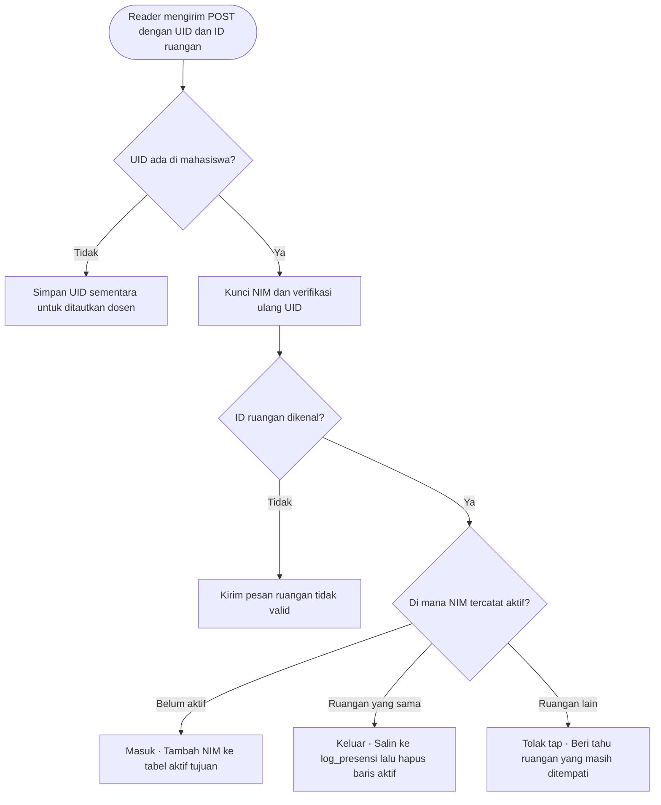

<p align="center">
  
</p>

<h1 align="center">KitaHadir</h1>

<p align="center">
  <strong>KitaHadir</strong> is a web-based application that utilizes RFID
  (Radio Frequency Identification) technology to support digital identification
  and attendance management. It aims to simplify data recording, improve
  efficiency, and provide a more convenient attendance management experience.
</p>

## Alur Kerja Aplikasi

**Login dosen.** Dosen mengisi formulir yang mengirim `POST /api/login`. Jika email dan kata sandi cocok dengan data MySQL, `LoginServlet.doPost()` membuat objek `Dosen` dan menyimpannya di sesi. Dashboard memeriksa sesi dengan `GET /api/me`. [LoginServlet](PresensiRFID/src/main/java/com/PresensiRFID/controller/LoginServlet.java)

**Tap RFID.** Kedua sensor mengirim UID dan ID ruangan sebagai formulir ke `POST /proses_rfid`. `AbsensiServlet` mencari NIM melalui UID, mengunci baris mahasiswa, memeriksa tautan kartu, lalu membaca posisi aktif. Reader menerima pesan teks setelah transaksi berhasil. [AbsensiServlet](PresensiRFID/src/main/java/com/PresensiRFID/controller/AbsensiServlet.java) · [TransaksiPresensi](PresensiRFID/src/main/java/com/PresensiRFID/util/TransaksiPresensi.java)



**Presensi manual.** Dosen membuka **Input Manual** di ruangan tujuan, lalu mengisi NIM, nama, kelas, dan UID opsional. Formulir dapat mengambil identitas NIM yang dikenal lewat `GET /api/tabel?jenis=mahasiswa&nim=...`. `POST /api/masuk` diteruskan ke `PresensiServlet.prosesMasuk()` untuk validasi, penyimpanan mahasiswa, dan pencatatan masuk. UID kosong mempertahankan kartu yang sudah tertaut. Jika mahasiswa masih aktif di ruangan mana pun, formulir menerima HTTP 409. Tombol **Keluar** mengirim NIM ke `POST /api/keluar`. `prosesKeluar()` memindahkan kunjungan aktif ke riwayat. Dashboard menampilkan pesan hasil dan mengambil data terbaru. [Formulir dashboard](PresensiRFID/src/main/webapp/index.html) · [PresensiServlet](PresensiRFID/src/main/java/com/PresensiRFID/controller/PresensiServlet.java)

**Penautan kartu.** Dosen menempelkan kartu baru, lalu memilih **Tautkan kartu** pada baris mahasiswa. `GET /api/kartu` mengambil UID terbaru dari `KartuTerakhir` dan membuang entri yang berumur lebih dari 60 detik. `POST /api/kartu` mengirim NIM dan UID ke `KartuServlet.doPost()` untuk memperbarui mahasiswa. Jika UID sudah dipakai mahasiswa lain, dashboard menerima HTTP 409. [KartuServlet](PresensiRFID/src/main/java/com/PresensiRFID/controller/KartuServlet.java) · [KartuTerakhir](PresensiRFID/src/main/java/com/PresensiRFID/util/KartuTerakhir.java)

**Impor CSV.** Di tab **Mahasiswa**, dosen memilih berkas UTF-8 hingga 2 MB dan menekan **Impor CSV**. Browser mengirim `POST /api/impor` sebagai `multipart/form-data` dengan bagian bernama `csv`. `BerkasCsv.bacaMahasiswa()` membaca header `NIM,Nama,Kelas,UID`, dengan kolom UID opsional. Contoh nama berkoma dan berkutip adalah `L123,"Nur, ""Nuri""",A,`. `BerkasServlet.impor()` menyimpan identitas yang valid melalui transaksi MySQL. UID kosong mempertahankan kartu lama. Jika format UID salah atau UID dimiliki NIM lain, identitas tetap dapat tersimpan dan alasan penolakan ditampilkan. Ringkasan memuat jumlah record data yang terbaca, jumlah mahasiswa tersimpan, dan alasan penolakan. Setelah commit, server membuang cache tabel dan total mahasiswa. Dashboard memuat ulang data. [BerkasCsv](PresensiRFID/src/main/java/com/PresensiRFID/util/BerkasCsv.java) · [BerkasServlet](PresensiRFID/src/main/java/com/PresensiRFID/controller/BerkasServlet.java)

Untuk NIM yang berulang, impor memproses record sesuai urutan berkas dan menghitung satu mahasiswa tersimpan per NIM. Nilai nama dan kelas dari record valid terakhir menjadi data terkini.

**Unduh CSV.** Di tampilan ruangan, dosen menekan **Unduh CSV**. `GET /api/ekspor?ruangan=17` atau `?ruangan=LAB` meminta `BerkasServlet.ekspor()` memeriksa ruangan dan mengambil semua mahasiswa yang sedang aktif di sana. `BerkasCsv.tulis()` mengirim lampiran UTF-8 bernama `data_hadir_<id_ruangan>.csv`. Ruangan kosong menghasilkan satu baris header. [BerkasServlet](PresensiRFID/src/main/java/com/PresensiRFID/controller/BerkasServlet.java) · [BerkasCsv](PresensiRFID/src/main/java/com/PresensiRFID/util/BerkasCsv.java)

Impor dan ekspor mengembalikan HTTP 401 jika sesi dosen tidak ada. [BerkasServlet](PresensiRFID/src/main/java/com/PresensiRFID/controller/BerkasServlet.java)

**Pencarian dan riwayat.** Pada tabel Mahasiswa atau Riwayat, pencarian mengirim `GET /api/tabel` dengan `jenis`, `cari`, dan `kolom`. `TabelServlet` mencari dan mengurutkan data lalu mengembalikan halaman berisi maksimal 20 baris. Tab Riwayat memakai `jenis=log` untuk melihat kunjungan selesai dari MySQL. Dashboard memakai `GET /api/data` setiap tiga detik untuk memperbarui status ruangan. [TabelServlet](PresensiRFID/src/main/java/com/PresensiRFID/controller/TabelServlet.java) · [DataServlet](PresensiRFID/src/main/java/com/PresensiRFID/controller/DataServlet.java)

**Catatan server.** `GET /api/status` melaporkan jumlah tap dan kondisi pembersih. `GET /api/catatan` membaca hingga 50 baris terakhir dari `catatan_presensi.txt` di folder kerja Tomcat. Pesan multiline diratakan saat ditulis agar satu kejadian tetap satu baris. [AwalServlet](PresensiRFID/src/main/java/com/PresensiRFID/controller/AwalServlet.java) · [BerkasServlet](PresensiRFID/src/main/java/com/PresensiRFID/controller/BerkasServlet.java) · [CatatanHarian](PresensiRFID/src/main/java/com/PresensiRFID/util/CatatanHarian.java)

## Penerapan Materi PBO

Gunakan **Find in Projects** di NetBeans atau pencarian workspace di VS Code dengan penanda seperti `PBO Modul 3`. Untuk presentasi, buka pemanggil pada setiap baris dan ikuti alur sampai hasil yang dilihat pengguna. Materinya meliputi Modul 1–6, 8, dan 9.

| Modul | Konsep | Lokasi kode | Kegunaan di aplikasi |
| --- | --- | --- | --- |
| 1 | Class, objek, constructor default implisit | [AbsensiServlet](PresensiRFID/src/main/java/com/PresensiRFID/controller/AbsensiServlet.java) · [Penghitung](PresensiRFID/src/main/java/com/PresensiRFID/util/Penghitung.java) · [AwalServlet](PresensiRFID/src/main/java/com/PresensiRFID/controller/AwalServlet.java) | `AbsensiServlet` membuat `new Penghitung()` dengan constructor default dari Java dan menambah hitungan tap. `AwalServlet.doGet()` menyajikan hitungan sejak aplikasi dimulai kepada dosen. |
| 1 | Constructor berparameter, overloading, `this(...)` | [MahasiswaAbsensi](PresensiRFID/src/main/java/com/PresensiRFID/model/MahasiswaAbsensi.java) · [PresensiServlet](PresensiRFID/src/main/java/com/PresensiRFID/controller/PresensiServlet.java) · [BerkasCsv](PresensiRFID/src/main/java/com/PresensiRFID/util/BerkasCsv.java) | `PresensiServlet.prosesMasuk()` dan `BerkasCsv.bacaMahasiswa()` membentuk objek dari identitas formulir atau CSV. Constructor empat parameter memanggil versi tiga parameter dengan `this(...)` lalu memeriksa UID opsional untuk penautan. |
| 2 | Primitif, referensi, percabangan, perulangan | [Penghitung](PresensiRFID/src/main/java/com/PresensiRFID/util/Penghitung.java) · [validasiNim()](PresensiRFID/src/main/java/com/PresensiRFID/model/MahasiswaAbsensi.java) · [BerkasCsv](PresensiRFID/src/main/java/com/PresensiRFID/util/BerkasCsv.java) · [BerkasServlet](PresensiRFID/src/main/java/com/PresensiRFID/controller/BerkasServlet.java) | `AbsensiServlet` merujuk objek `Penghitung` yang menyimpan jumlah tap sebagai `int`. Impor dan formulir merujuk objek `MahasiswaAbsensi`. `if` memeriksa input, `switch` memilih unduhan atau catatan, dan `for` berindeks di `validasiNim()` memeriksa angka mulai karakter kedua. `BerkasCsv.bacaMahasiswa()` memakai `while` untuk membaca nol atau lebih record. Saat posisi kutip salah, `do-while` di `bacaRecord()` membaca sedikitnya sekali hingga akhir baris atau berkas agar record berikutnya bisa diproses. `for-each` menyimpan objek hasil impor. |
| 3 | `Character`, `String`, `StringBuilder`, exception, `throw`, `throws`, `try-catch`, `finally` | [MahasiswaAbsensi](PresensiRFID/src/main/java/com/PresensiRFID/model/MahasiswaAbsensi.java) · [NimTidakValidException](PresensiRFID/src/main/java/com/PresensiRFID/model/NimTidakValidException.java) · [BerkasCsv](PresensiRFID/src/main/java/com/PresensiRFID/util/BerkasCsv.java) · [PresensiServlet](PresensiRFID/src/main/java/com/PresensiRFID/controller/PresensiServlet.java) · [PemuatData](PresensiRFID/src/main/java/com/PresensiRFID/util/PemuatData.java) | Parser menyusun kolom dengan `StringBuilder`. Formulir dan impor memanggil `validasiNim()` dengan `String` NIM. `Character` memeriksa huruf dan angka. Saat gagal, `throw` melempar `NimTidakValidException` yang tercantum dalam `throws`. `catch` menerjemahkannya menjadi HTTP 400 pada formulir atau alasan penolakan per record pada impor. Pada pemuat, try-with-resources menutup koneksi, lalu `finally` melepas referensi yang dipakai `hentikan()`. |
| 4 | Array objek tetap, `ArrayList`, `LinkedList`, `Iterator`, CRUD objek di memori | [AwalServlet](PresensiRFID/src/main/java/com/PresensiRFID/controller/AwalServlet.java) · [BerkasCsv](PresensiRFID/src/main/java/com/PresensiRFID/util/BerkasCsv.java) · [KartuTerakhir](PresensiRFID/src/main/java/com/PresensiRFID/util/KartuTerakhir.java) · [KartuServlet](PresensiRFID/src/main/java/com/PresensiRFID/controller/KartuServlet.java) | `AwalServlet.init()` mengisi array tiga pemuat agar tabel lebih cepat tampil. Parser mengumpulkan hasil impor dalam `ArrayList`. `AbsensiServlet` membuat entri kartu baru pada `LinkedList` dan memperbarui waktu serta urutannya saat ditap lagi. `KartuServlet` membaca UID terbaru untuk formulir, lalu menghapus entri setelah ditautkan. `Iterator` menghapus entri kedaluwarsa atau yang cocok dengan UID. |
| 5 | I/O, CSV UTF-8, try-with-resources, persistensi file | [BerkasCsv](PresensiRFID/src/main/java/com/PresensiRFID/util/BerkasCsv.java) · [BerkasServlet](PresensiRFID/src/main/java/com/PresensiRFID/controller/BerkasServlet.java) · [CatatanHarian](PresensiRFID/src/main/java/com/PresensiRFID/util/CatatanHarian.java) | Parser mengubah record unggahan UTF-8 menjadi objek mahasiswa. Saat diunduh, penulis mengubah objek peserta menjadi record CSV, dengan kutip untuk melindungi koma, kutip ganda, dan baris baru. Try-with-resources menutup pembaca, penulis, dan alirannya. `CatatanHarian` menyimpan satu kejadian per baris, dan `GET /api/catatan` membaca kembali file setelah restart Tomcat dengan folder kerja yang sama. |
| 6 | Atribut privat, getter, setter, pewarisan, `super` | [Pengguna](PresensiRFID/src/main/java/com/PresensiRFID/model/Pengguna.java) · [Dosen](PresensiRFID/src/main/java/com/PresensiRFID/model/Dosen.java) · [MahasiswaAbsensi](PresensiRFID/src/main/java/com/PresensiRFID/model/MahasiswaAbsensi.java) | `LoginServlet` membuat `Dosen`, sedangkan presensi dan impor membuat `MahasiswaAbsensi`. `super(...)` mengisi nama dan ID privat di `Pengguna`. Getter membaca identitas untuk penyimpanan atau respons. `super.ringkas()` memberi ringkasan dasar bagi kedua turunan. Setter UID menerima 8–20 karakter heksadesimal dan menyimpan huruf kapital. Input salah mempertahankan nilai lama, termasuk `null` pada objek baru. |
| 8 | Class abstrak, method abstrak, overriding, polimorfisme | [Pengguna](PresensiRFID/src/main/java/com/PresensiRFID/model/Pengguna.java) · [PresensiServlet](PresensiRFID/src/main/java/com/PresensiRFID/controller/PresensiServlet.java) | Class abstrak `Pengguna` menyimpan identitas dan menyediakan `ringkas()`. Method abstrak `getPeran()` memberi kontrak yang diimplementasikan setiap turunan. `prosesMasuk()` menaruh `Dosen` dan `MahasiswaAbsensi` dalam `Pengguna[]`. Java memilih override `ringkas()` sesuai tipe objek saat runtime. Catatan setelah commit memuat email dosen dan kelas mahasiswa. |
| 8 | Interface `Kartu` dan `DapatDiekspor` | [MahasiswaAbsensi](PresensiRFID/src/main/java/com/PresensiRFID/model/MahasiswaAbsensi.java) · [Kartu](PresensiRFID/src/main/java/com/PresensiRFID/model/Kartu.java) · [DapatDiekspor](PresensiRFID/src/main/java/com/PresensiRFID/model/DapatDiekspor.java) · [BerkasServlet](PresensiRFID/src/main/java/com/PresensiRFID/controller/BerkasServlet.java) · [BerkasCsv](PresensiRFID/src/main/java/com/PresensiRFID/util/BerkasCsv.java) | `MahasiswaAbsensi` mendeklarasikan `implements DapatDiekspor, Kartu`. Presensi manual dan impor memakai `sudahTerdaftar()` serta `getUidRfid()` untuk mengatur penyimpanan UID. Penulis menerima daftar bertipe `List<DapatDiekspor>` dan memanggil `keBarisCsv()` untuk setiap peserta. |
| 9 | `Thread`, `start()`, `join()`, `Runnable`, `sleep()`, `interrupt()` | [AwalServlet](PresensiRFID/src/main/java/com/PresensiRFID/controller/AwalServlet.java) · [PemuatData](PresensiRFID/src/main/java/com/PresensiRFID/util/PemuatData.java) · [PembersihPresensi](PresensiRFID/src/main/java/com/PresensiRFID/util/PembersihPresensi.java) | Saat startup, `AwalServlet.init()` menjalankan tiga `PemuatData extends Thread` untuk menyiapkan cache. Servlet juga menjalankan `PembersihPresensi implements Runnable`, yang tidur sepuluh menit antar pemeriksaan dan menutup kunjungan lebih dari 12 jam. Saat shutdown, `destroy()` memanggil `interrupt()`, membatalkan koneksi pemuat yang masih aktif, lalu menunggu worker dengan `join()` memakai sisa waktu dari satu tenggat 15 detik. |
| 9 | `synchronized` dan penguncian baris MySQL | [KartuTerakhir](PresensiRFID/src/main/java/com/PresensiRFID/util/KartuTerakhir.java) · [Penghitung](PresensiRFID/src/main/java/com/PresensiRFID/util/Penghitung.java) · [TransaksiPresensi](PresensiRFID/src/main/java/com/PresensiRFID/util/TransaksiPresensi.java) | Monitor Java menjaga daftar UID sementara dan hitungan tap di memori proses. Kunci baris NIM di MySQL mengoordinasikan transaksi dari koneksi berbeda agar posisi dan riwayat kunjungan tetap konsisten. |

## Penerapan Materi Basis Data

| Pertemuan atau topik | Konsep | Lokasi kode | Kegunaan di aplikasi |
| --- | --- | --- | --- |
| Pertemuan 2 | DDL dan data awal | [Query.sql](DataBase/Query.sql) · [Pembuatan akun](DataBase/buat_akun_dosen.py) | Skrip skema membuat database dan enam tabel InnoDB. `DROP TABLE` menghapus tabel lama saat skrip dijalankan ulang. `INSERT` menyiapkan ruangan dan mahasiswa awal. Skrip akun memasukkan identitas dan hash dari kredensial yang dimasukkan pengguna. |
| Pertemuan 2 | Primary key, UNIQUE, dan NOT NULL | [Query.sql](DataBase/Query.sql) | NIM membedakan mahasiswa. `UNIQUE` membatasi UID terisi untuk satu NIM, dan mahasiswa tanpa kartu dapat menyimpan `NULL`. NIM aktif unik per tabel ruangan, dan transaksi memakai kunci NIM untuk memeriksa posisi lintas ruangan. |
| Pertemuan 2 | Foreign key dan ON DELETE CASCADE | [Query.sql](DataBase/Query.sql) | Tabel aktif dan riwayat merujuk NIM yang sudah ada di tabel mahasiswa. Riwayat juga merujuk ID ruangan. Penghapusan data induk melalui SQL merambat ke baris yang merujuknya. |
| Pertemuan 2 | DML dengan INSERT, UPDATE, dan DELETE | [PresensiServlet](PresensiRFID/src/main/java/com/PresensiRFID/controller/PresensiServlet.java) · [BerkasServlet.simpanMahasiswa()](PresensiRFID/src/main/java/com/PresensiRFID/controller/BerkasServlet.java) · [KartuServlet](PresensiRFID/src/main/java/com/PresensiRFID/controller/KartuServlet.java) | Impor dan input manual memakai `INSERT ... ON DUPLICATE KEY UPDATE` untuk menambah mahasiswa atau memperbarui identitas berdasarkan NIM. Penautan menjalankan `UPDATE` UID. Keluar manual menghapus baris aktif setelah menyalin kunjungan ke riwayat. |
| Pertemuan 4 | SELECT dan WHERE | [AbsensiServlet.cariNim()](PresensiRFID/src/main/java/com/PresensiRFID/controller/AbsensiServlet.java) · [LoginServlet.doPost()](PresensiRFID/src/main/java/com/PresensiRFID/controller/LoginServlet.java) | Tap mencari mahasiswa dengan `WHERE uid_rfid = ?` dan memeriksa NIM di tabel aktif. Login menyaring akun menurut email dan hash kata sandi. |
| Pertemuan 5 | JOIN dan LEFT JOIN | [DataServlet.doGet()](PresensiRFID/src/main/java/com/PresensiRFID/controller/DataServlet.java) · [BerkasServlet.ekspor()](PresensiRFID/src/main/java/com/PresensiRFID/controller/BerkasServlet.java) · [DataMemori.SQL_LOG](PresensiRFID/src/main/java/com/PresensiRFID/util/DataMemori.java) | `JOIN` mengambil identitas dari tabel mahasiswa untuk tampilan dan unduhan peserta aktif. Dua `LEFT JOIN` melengkapi nama mahasiswa dan nama ruangan untuk tab riwayat. |
| Pertemuan 5 | Agregasi COUNT dan MAX | [CacheTotal.hitung()](PresensiRFID/src/main/java/com/PresensiRFID/util/CacheTotal.java) · [DataMemori.LOG](PresensiRFID/src/main/java/com/PresensiRFID/util/DataMemori.java) | `COUNT(*)` memberi total untuk dashboard. Impor membuang cache jumlah dan isi tabel mahasiswa setelah commit. `MAX(id_log)` membantu cache menentukan kapan membaca kunjungan yang lebih baru. |
| Transaksi JDBC | `FOR UPDATE`, upsert, READ COMMITTED, commit dan rollback | [TransaksiPresensi](PresensiRFID/src/main/java/com/PresensiRFID/util/TransaksiPresensi.java) · [AbsensiServlet](PresensiRFID/src/main/java/com/PresensiRFID/controller/AbsensiServlet.java) · [PresensiServlet](PresensiRFID/src/main/java/com/PresensiRFID/controller/PresensiServlet.java) · [PembersihPresensi](PresensiRFID/src/main/java/com/PresensiRFID/util/PembersihPresensi.java) · [BerkasServlet](PresensiRFID/src/main/java/com/PresensiRFID/controller/BerkasServlet.java) | Tap, presensi manual, dan pembersih mengunci baris induk NIM lalu membaca status terkini. Masuk manual mendapat kunci lewat upsert, termasuk untuk NIM baru. Pembersih memeriksa ulang ID dan umur setelah mengunci, lalu menutup satu kunjungan per transaksi. Ketiga jalur keluar memakai satu commit untuk menyalin riwayat dan menghapus baris aktif. Konflik UID membatalkan masuk manual, sedangkan impor mencatat konflik dan melanjutkan identitas yang valid. |

Materi Basis Data untuk nomor pertemuan mengikuti [DDL dan DML dasar](https://fiuly.github.io/Praktikum-DBMS-Informatika-Kelas-A-B/docs/pertemuan-2/), [kueri dasar](https://fiuly.github.io/Praktikum-DBMS-Informatika-Kelas-A-B/docs/pertemuan-4/), dan [kueri lanjutan](https://fiuly.github.io/Praktikum-DBMS-Informatika-Kelas-A-B/docs/pertemuan-5/).

## Build dan deploy lokal

1. Untuk database baru, jalankan dari root workspace `mysql --host=127.0.0.1 --user=root --execute="source DataBase/Query.sql"`. Gunakan `-p` jika akun MySQL memakai kata sandi. `Query.sql` menghapus enam tabel di `db_absensi` jika dijalankan ulang. Untuk database yang sudah dipakai, deploy WAR langsung. [Query.sql](DataBase/Query.sql)
2. Untuk membuat akun dosen, jalankan `python DataBase/buat_akun_dosen.py` dari terminal. Masukkan NIP, nama, email login, dan kata sandi pilihan sendiri dengan minimal 12 karakter. Skrip menambahkan akun baru dan memakai format hash SHA-256 yang juga dapat dibaca `LoginServlet` untuk akun lama. Untuk database yang masih memiliki akun dengan sandi awal dari versi lama, ganti sandinya sebelum menerbitkan dashboard. Jika kredensial Wi-Fi lama pernah dibagikan di repo, ganti juga kata sandi Wi-Fi. [Skrip akun dosen](DataBase/buat_akun_dosen.py)
3. Jalankan `gradle build test` dari direktori `PresensiRFID` dengan JDK 21 dan Gradle 9.9.x. Hasil build ada di `PresensiRFID/build/libs/PresensiRFID.war`. Gunakan nama WAR itu saat deploy agar context path tetap `/PresensiRFID`. [build.gradle](PresensiRFID/build.gradle)

Tomcat dan MySQL berjalan lokal. `Db` memakai MySQL `localhost:3306/db_absensi` secara default. Jika berbeda, atur `KITAHADIR_DB_URL`, `KITAHADIR_DB_USER`, dan `KITAHADIR_DB_PASSWORD` di lingkungan proses Tomcat. Contoh URL untuk instance uji adalah `jdbc:mysql://127.0.0.1:43306/db_absensi?useSSL=false&characterEncoding=UTF-8`. [Db](PresensiRFID/src/main/java/com/PresensiRFID/util/Db.java)

### Seed untuk pengujian

`DataBase/impor.bat` menjalankan `Query.sql` yang berada di samping skrip, lalu empat berkas seed. Skrip berhenti pada perintah pertama yang gagal dan mencatat hasil ke `log_impor.txt` di folder seed. Uji skrip ini hanya pada instance MySQL uji yang terpisah karena nama schema tetap `db_absensi`.

Kedua skrip memakai `KITAHADIR_MYSQL_EXE` jika MySQL CLI berada di luar `PATH`. Jika `KITAHADIR_MYSQL_LOGIN_PATH` diisi dengan nama profil dari `mysql_config_editor`, host, port, dan user mengikuti profil. Variabel `KITAHADIR_MYSQL_HOST`, `KITAHADIR_MYSQL_PORT`, dan `KITAHADIR_MYSQL_USER` mengesampingkan nilai masing-masing bila diisi. Tanpa login path, nilai bawaan adalah TCP ke `127.0.0.1:3306` sebagai `root`. Skrip akun dapat memakai konfigurasi ini untuk menambah akun pada database lokal yang sudah ada. [impor.bat](DataBase/impor.bat) · [Skrip akun dosen](DataBase/buat_akun_dosen.py)

Khusus `impor.bat`, tetapkan `KITAHADIR_MYSQL_PORT` secara eksplisit ke port instance uji meskipun login path sudah menyimpan port. Skrip memeriksa port, mencatat target koneksi, dan menampilkan identitas server sebelum meminta konfirmasi. Periksa baris `Instance MySQL` lalu ketik `YA` untuk menjalankan `Query.sql`. Jawaban lain, input kosong, atau kegagalan koneksi menghentikan skrip sebelum tabel dihapus. Atur `KITAHADIR_SEED_DIR` jika berkas seed berada di luar folder skrip. Contoh PowerShell untuk instance uji pada port `43306`:

```powershell
$env:KITAHADIR_MYSQL_PORT = '43306'
$env:KITAHADIR_SEED_DIR = 'C:\folder-seed-uji'
.\DataBase\impor.bat
```

Untuk membuat seed kecil, jalankan `python DataBase/generate_seed.py 100 10 "folder-seed"` lalu `python DataBase/generate_log.py "folder-seed/seed_mahasiswa.sql" "folder-seed" 200`. [Generator mahasiswa dan dosen](DataBase/generate_seed.py) · [Generator riwayat](DataBase/generate_log.py)

## Koneksi dan demo

| Akses | Alamat contoh |
| --- | --- |
| ESP32 lewat Wi-Fi LAN | `http://192.168.1.10:8080/PresensiRFID/` |
| Origin web untuk `cloudflared` di PC server | `http://127.0.0.1:8081` |
| Dashboard dosen dari luar LAN | `https://<nama-tunnel>.trycloudflare.com/PresensiRFID/` |

Dua listener HTTP Tomcat melayani satu deployment KitaHadir. `AbsensiServlet` hanya menerima tap pada port LAN yang ditetapkan di Tomcat. Listener web mengembalikan HTTP 404 untuk handler itu, termasuk saat ada sesi dosen. Dashboard tetap membaca presensi dari `/api/data` dan `/api/tabel`, serta UID kartu baru dari `/api/kartu`, dengan autentikasi sesi dosen.

### Siapkan PC server

1. Jalankan `ipconfig` dan catat **IPv4 Address** pada adapter Wi-Fi atau Ethernet yang satu jaringan dengan ESP32. `192.168.1.10` adalah contoh. Jika memungkinkan, reservasi alamat tersebut di DHCP router agar konfigurasi firmware tetap cocok setelah restart.
2. Gunakan [contoh konfigurasi Tomcat](deploy/tomcat/server.example.xml) sebagai `%CATALINA_BASE%\conf\server.xml` pada instance khusus KitaHadir. Untuk `CATALINA_BASE` baru, salin dulu folder `conf` bawaan Tomcat. Cadangkan file lama jika sudah ada. Ganti `address="192.168.1.10"` dengan IPv4 yang ditemukan. Pertahankan `127.0.0.1:8081` untuk origin web. Buat folder `%CATALINA_BASE%\webapps-kitahadir` dan salin `PresensiRFID.war` ke sana. Jika MySQL berjalan di Laragon atau XAMPP, jalankan layanan MySQL di sana. Kedua listener HTTP tetap dikelola Tomcat.
3. Pada Windows Firewall, izinkan TCP `8080` dari subnet LAN ESP32 pada profil Private. Jaga port LAN bebas dari port forwarding router dan proxy publik. Hentikan instance Tomcat lama yang masih memakai port `8080` dan tunnel lama yang masih meneruskan request ke port itu. Jika menyesuaikan port LAN, tetapkan properti JVM `-Dkitahadir.reader.port=<port>` di `CATALINA_OPTS` dan gunakan port yang sama pada firewall serta `READER_BASE_URL`.
4. Buka PowerShell, isi `KITAHADIR_READER_TOKEN` dengan token acak pilihan sendiri, lalu mulai Tomcat dari sesi yang sama. Jika `CATALINA_BASE` kosong, contoh ini mengasumsikan konfigurasi dan WAR dipasang di `CATALINA_HOME`.

   ```powershell
   $env:CATALINA_HOME = 'C:\path\ke\apache-tomcat-11'
   $env:KITAHADIR_READER_TOKEN = '<TOKEN_READER_ACAK>'
   & "$env:CATALINA_HOME\bin\catalina.bat" run
   ```

### Atur dan unggah firmware ESP32

Gunakan Arduino ESP32 core 3.3.12 dan library `MFRC522` serta `LiquidCrystal_I2C`. Di `Arduino/PresensiRFID`, salin `ReaderConfig.example.h` menjadi `ReaderConfig.h` jika belum tersedia. Isi `WIFI_SSID` dan `WIFI_PASSWORD` untuk jaringan ESP32, lalu samakan `READER_TOKEN` dengan token Tomcat. Sesuaikan `READER_BASE_URL` dengan IPv4 LAN server. Git mengabaikan `ReaderConfig.h`. Buka `PresensiRFID.ino` di folder itu, lalu kompilasi dan unggah. Gunakan LAN tepercaya karena token dan tap dikirim lewat HTTP. [Template reader](Arduino/PresensiRFID/ReaderConfig.example.h) · [Sketch](Arduino/PresensiRFID/PresensiRFID.ino)

Reader mengirim `POST /PresensiRFID/proses_rfid` dengan header `X-Reader-Token`, `Content-Type: application/x-www-form-urlencoded`, dan badan seperti `uid=A1B2C3D4&id_ruangan=17`. Kedua sensor tetap memakai ID `17` dan `LAB` serta cooldown 2,5 detik per kartu.

| Respons tap | Makna di reader |
| --- | --- |
| `200` dengan `X-Presensi-Hasil: masuk` atau `keluar` | LCD menampilkan hasil dan nama mahasiswa. |
| `409` dengan `X-Presensi-Hasil: tolak` atau `kartu_baru` | LCD menampilkan alasan atau pesan kartu belum terdaftar untuk ditautkan dosen. |
| `403` | LCD menampilkan kesalahan HTTP. Periksa `READER_TOKEN` di firmware dan `KITAHADIR_READER_TOKEN` di Tomcat. |
| `400`, `404`, `500`, redirect, atau respons di luar kontrak | LCD menampilkan kesalahan HTTP atau pesan galat server. |
| Koneksi putus, timeout, atau respons terpotong | LCD meminta pengguna memeriksa status di dashboard. |

Respons tap memakai `Cache-Control: no-store`. Firmware membatasi waktu koneksi dan baca serta mematikan redirect. Setiap tap menghasilkan paling banyak satu POST dari firmware. Jika hasil belum diketahui, periksa dashboard sebelum tap ulang karena tap berikutnya di ruangan yang sama dapat membalik status.

### Buka dashboard dengan Cloudflare Quick Tunnel

Di terminal lain pada PC server, jalankan perintah ini. Quick Tunnel menyediakan URL sementara tanpa domain sendiri. [Dokumentasi Quick Tunnel](https://developers.cloudflare.com/tunnel/get-started/quick-tunnels/)

```powershell
cloudflared tunnel --url http://127.0.0.1:8081
```

Cari URL `https://…trycloudflare.com` di output terminal. Tambahkan `/PresensiRFID/` pada akhir URL itu dan kirim tautan lengkap ke dosen. Biarkan terminal tetap berjalan selama demo. Dosen masuk menggunakan akun KitaHadir. Setiap kali Quick Tunnel dimulai ulang, ambil URL baru dari output terminal.

1. Dari jaringan luar LAN, buka URL demo, login, dan buka ruangan tempat reader diuji. Tap kartu uji yang sudah ditautkan lalu periksa bahwa nama muncul di daftar aktif. Tap lagi setelah cooldown dan periksa tab **Riwayat**. Untuk kartu baru, periksa **Tautkan kartu** dalam 60 detik setelah tap.
2. Pastikan `POST /PresensiRFID/proses_rfid` ke URL HTTPS demo mengembalikan 404 tanpa `X-Presensi-Hasil`, termasuk ketika browser sudah login. Pada listener LAN, request tanpa token atau dengan token salah harus menghasilkan 403.
3. Hentikan `cloudflared` dengan Ctrl+C dan tap kartu uji saat Tomcat dan MySQL tetap berjalan. Periksa respons LCD atau dashboard LAN. Nyalakan kembali Quick Tunnel, buka URL yang baru, dan pastikan dashboard menampilkan hasil tap tersebut.
